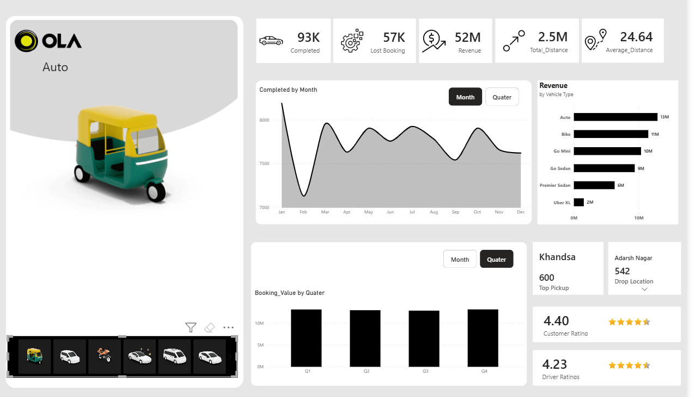

# 🚖 Ola Ride Booking & Revenue Dashboard

## 📌 Project Overview
The **Ola Ride Booking & Revenue Dashboard** is an interactive data analytics project designed to analyze ride-booking performance, revenue generation, trip distances, booking trends, and customer and driver ratings. It provides business insights through KPIs, charts, and location-based metrics.

## 🎯 Business Objectives
- Monitor completed rides and lost bookings.
- Analyze revenue generated by vehicle type.
- Track monthly and quarterly booking trends.
- Identify top pickup and drop locations.
- Evaluate customer and driver ratings.
- Understand trip-distance patterns and business performance.

## 📊 Dashboard Highlights

### Key Performance Indicators (KPIs)
- **Completed Rides:** 3K
- **Lost Bookings:** 2K
- **Revenue:** 2M
- **Total Distance:** 74.3K
- **Average Distance:** 24.40

### Visualizations
- **Monthly Completed Rides:** Tracks ride completion trends throughout the year.
- **Revenue by Vehicle Type:** Displays revenue generated by Ola XL.
- **Quarterly Booking Value:** Compares booking value across four quarters.
- **Top Pickup Location:** Highlights Jhilmi as the leading pickup location.
- **Top Drop Location:** Identifies Adarsh Nagar as a key drop location.
- **Customer Ratings:** Displays an average customer rating of 4.40.
- **Driver Ratings:** Displays an average driver rating of 4.24.
- **Vehicle Selection Panel:** Enables visual exploration of different vehicle categories.

## 🛠️ Tools & Technologies
- **Data Visualization:** Interactive dashboarding
- **Data Analysis:** KPI tracking, trend analysis, and aggregation
- **Business Intelligence:** Revenue analysis and operational performance monitoring


## 💡 Key Business Insights
- The dashboard reports approximately 3K completed rides and 2K lost bookings.
- Monthly ride completion fluctuates, with a visible peak around April–May.
- Ola XL contributes approximately 1.5M in revenue.
- Quarterly booking value remains relatively consistent, with Q2 showing the highest value among the displayed quarters.
- Customer ratings (4.40) are higher than driver ratings (4.24).


## 🚀 How to Use
1. Clone or download this repository.
2. Open the dashboard using the relevant visualization tool.
3. Connect or load the source dataset, if required.
4. Explore monthly and quarterly trends, revenue, trip distances, and ratings.
5. Use the insights to investigate operational performance and potential improvement areas.

## 📁 Repository Structure
```text
ola-ride-booking-dashboard/
├── README.md
├── images/
│   └── dashboard.png
├── data/
│   └── dataset.csv
└── project-files/
    └── dashboard-file
```

## 📷 Dashboard Preview



## 📈 Business Value
This dashboard helps stakeholders monitor ride-booking performance, identify trends, evaluate revenue contribution, and understand customer experience through data-driven reporting.

## 👤 Author
**Rajan Kumar Jha**

Data Analyst | SQL | Excel | Power BI | Python

## ⭐ Support
If you find this project useful, consider giving the repository a star!
